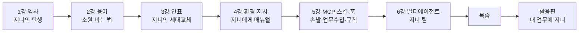

# AI 이해부터 에이전트 개발까지 (강의 안내)

![[images/aiax_ig_00_overview.png|일곱 정거장을 지나면 내 일을 AI에게 맡길 수 있어요]]

## 강의 순서

| 강 | 주제 | 핵심 질문 | 시간 |
|---|---|---|---|
| 안내 | 과정 소개 | 오늘 무엇을 가져가나? | 5분 |
| 1강 | AI의 태동과 역사 | AI는 어디서 왔나? | 25분 |
| 2강 | AI 핵심 용어 | AI와 어떻게 말하고, 무엇을 경계하나? | 25분 |
| 3강 | 생성형 AI 모델 연표 (2022~2026.10) | 지금 AI는 어디까지 왔나? | 25분 |
| 4강 | 에이전트 환경과 지시 설계 | AI에게 일을 맡기려면 무엇을 준비하나? | 25분 |
| 5강 | MCP·스킬·훅 | 에이전트에게 손발·매뉴얼·규칙을 어떻게 주나? | 25분 |
| 6강 | 멀티에이전트와 업무 자동화 | 여러 에이전트로 일 하나를 끝까지 끝내려면? | 25분 |
| 복습 | 1~6강 | 무엇을 배웠나? | 10분 |
| 활용편 | 내 업무에 적용 | 이제 무엇을 맡길까? | 30분 |
| 부록 | 실습 키트 | 지시문·소스를 복사해 바로 실습 | 실습용 |
| 부록 | 약어 사전 | 이 약어는 무슨 뜻? | 참고용 |

## 전체를 꿰는 비유: 요술 램프 지니

| 강 | 지니 이야기 | 실제 개념 |
|---|---|---|
| 1강 | 지니가 태어나기까지 70년 | 튜링 질문 → 겨울 → 딥러닝 → 대화형 AI |
| 2강 | 소원을 정확히 비는 법 | 프롬프트, 리터러시 |
| 3강 | 지니가 해마다 똑똑해진다 | 모델 세대교체, 추론, 에이전트 |
| 4강 | 지니에게 업무 수첩을 준다 | CLAUDE.md, 권한, 계획 모드 |
| 5강 | 지니에게 손발과 규칙을 준다 | MCP, 스킬, 훅 |
| 6강 | 지니 여러 명이 팀으로 일한다 | 서브에이전트, 작성자·검토자 분리 |

## 이 강의를 듣고 나면

1. **이해**: AI가 걸어온 길과 핵심 용어, 2026년 현재 모델 지형을 설명한다.
2. **판단**: 내 업무 중 AI에게 맡길 일과 맡기면 안 되는 일을 네 가지 기준으로 가른다.
3. **실행**: CLAUDE.md, 스킬 1개, 검토 에이전트 1개로 반복 업무 1건을 자동화하는 첫 버전을 만든다.

## 나는 누구일까요? 내 상황 고르기

> [!persona-pick] 나는 어떤 일을 하나요?
> - 현장 대원 (화재·구조·구급)
> - 행정·사무
> - 예방·안전
> - 처음 배우는 분
>
> 사이트에서 고르면 강의 곳곳의 예시가 내 상황에 맞게 바뀝니다. 왼쪽 위 "내 상황"에서 언제든 바꿀 수 있습니다.

## 대상과 준비물

| 구분 | 내용 |
|---|---|
| 대상 | 소방공무원 교육생 (생성형 AI 사용 경험 기초, 코딩 비전공) |
| 방식 | 설명 30% / 따라 하기 50% / 시연·질의 20% |
| 준비물 | 노트북, Claude 계정, Node.js 18 이상, Git, 실습 폴더 `agent-lab` |
| 1~3강 | 별도 설치 없이 들을 수 있음 |
| 4~6강 | Claude Code 설치 필요 (사전 안내) |

> [!warning] 실습 안내
> 실습에는 실제 개인정보·내부 문서를 넣지 않습니다. 모든 실습 데이터는 가짜 예시 데이터를 씁니다.

## 용어 사전

| 용어 | 원어 | 쉬운 뜻 |
|---|---|---|
| 인공지능 | AI, Artificial Intelligence | 사람처럼 배우고 판단하는 기계 |
| 머신러닝 | Machine Learning | 자료를 보고 기계가 스스로 규칙을 찾는 방식 |
| 딥러닝 | Deep Learning | 인공 신경망을 여러 층 쌓아 배우는 방식 |
| 거대언어모델 | LLM, Large Language Model | 엄청난 양의 글로 "다음 말"을 맞히며 배운 AI |
| 모델 | Model | AI의 뇌. ChatGPT는 서비스, GPT-5는 모델 |
| 프롬프트 | Prompt | AI에게 하는 말(지시) 전체 |
| 컨텍스트 | Context | AI가 한 번에 보고 기억하는 자료의 범위 |
| 추론 모델 | Reasoning Model | 답하기 전에 속으로 차근차근 생각하는 모델 |
| 에이전트 | Agent | 목표를 주면 계획하고 도구를 써서 일을 끝내는 AI |
| MCP | Model Context Protocol | 에이전트가 외부 도구·데이터에 연결되는 표준 규격 |
| 스킬 | Skill | 반복 업무 절차를 묶은 에이전트용 업무 수첩 |
| 훅 | Hook | 특정 시점에 무조건 실행되는 자동 규칙 |
| AX | AI Transformation | AI로 일하는 방식 자체를 바꾸는 것 |

> [!tip] 바로 가기
> 실습에 쓰는 지시문과 소스는 [[AIAX_97_실습키트|실습 키트]]에서 복사합니다. 실습 폴더는 agent-lab.zip으로 함께 배포합니다.
>
> [[AIAX_01_AI의태동과역사|1강 AI의 태동과 역사]]부터 시작합니다. 시간이 부족하면 1~3강은 요약만, 4~6강은 실습 위주로 운영합니다.
