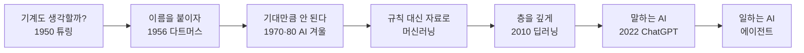

# 1강. AI의 태동과 역사

![[images/aiax_ig_01_history.png|AI가 자라 온 70년, 겨울을 지나 다시 달렸어요]]

> [!question] 생각해 보기
> 스마트폰 사진첩에 "강아지"라고 치면 강아지 사진만 모여 나옵니다. 누가 사진마다 "강아지"라고 적어 둔 걸까요? 아니라면 기계는 강아지를 어떻게 알아봤을까요?

## 0. 한 줄 흐름



AI 역사는 "기대 → 실망 → 새 방법"의 반복입니다. 각 단계는 앞 단계의 문제를 푼 해결책입니다.

## 1. 문제: 기계가 생각한다는 걸 어떻게 알까 (1950년대)

- **1950년, 앨런 튜링**: "기계도 생각할 수 있을까?"라는 질문을 던졌습니다. 커튼 뒤 상대가 사람인지 기계인지 구별하지 못하면 생각한다고 보자는 시험, **튜링 테스트(Turing Test)** 를 제안했습니다.
- **1956년, 다트머스 회의**: 존 매카시가 처음으로 **인공지능(Artificial Intelligence)** 이라는 이름을 붙였습니다. 이 해를 AI의 생일로 봅니다.
- **1958년, 퍼셉트론(Perceptron)**: 뇌의 신경세포를 흉내 낸 단순한 기계. 오늘날 신경망의 출발점입니다.

> [!example] 생활 속 비유
> 지니(AI)라는 아이디어가 처음 종이에 그려진 때입니다. 아직 램프 안에는 아무것도 없습니다.

## 2. 문제: 기대만큼 똑똑하지 않다 → AI의 겨울 (1970~80년대)

| 시기 | 무엇을 했나 | 왜 실패했나 |
|---|---|---|
| 1970년대 | "몇 년이면 사람 수준"이라 기대 | 컴퓨터가 느리고 배울 자료가 부족 |
| 1980년대 | **전문가 시스템**: 전문가 지식을 "만약 ~이면 ~이다" 규칙으로 입력 | 세상일은 규칙으로 다 적을 수 없음. 규칙이 많아지자 관리 불가 |

연구비가 끊긴 이 시기를 **AI의 겨울(AI Winter)** 이라고 부릅니다. 겨울은 두 번 왔습니다.

> [!example] 바로 해 보기: 규칙으로 화재 판단하기
> 1. 종이에 "화재 신고가 진짜인지 판단하는 규칙"을 5개만 적어 봅니다. (예: 연기 목격 + 냄새 = 진짜)
> 2. 옆 사람이 규칙에 안 맞는 예외 상황을 하나 말해 봅니다.
> 3. 규칙을 하나 더 추가합니다. 다시 예외를 찾습니다.
> 성공 확인: 규칙이 끝없이 늘어나는 것을 체감하면 성공. 이것이 전문가 시스템이 무너진 이유입니다.

## 3. 해결: 규칙을 사람이 쓰지 말고 기계가 찾게 하자 (1990~2000년대)

- **1997년, 딥블루(Deep Blue)**: IBM 컴퓨터가 체스 챔피언 카스파로프를 이겼습니다. 방식은 엄청나게 빠른 계산이었습니다.
- 이때부터 중심이 **머신러닝(Machine Learning)** 으로 바뀝니다. 강아지 사진 수만 장을 보여주면 기계가 스스로 강아지의 특징을 찾습니다.

생각해 보기의 답이 여기 있습니다. 누가 사진마다 이름을 적은 게 아니라, 기계가 수많은 예시로 "강아지다움"을 스스로 배운 것입니다.

## 4. 해결: 층을 깊게 쌓자, 딥러닝 혁명 (2010년대)

세 가지가 동시에 갖춰지면서 AI가 갑자기 똑똑해졌습니다.

| 재료 | 내용 |
|---|---|
| 많은 자료 | 인터넷·스마트폰으로 사진, 글, 영상이 넘쳐남 |
| 빠른 계산 | 게임용 그래픽카드(GPU)가 AI 학습에 딱 맞음 |
| 깊은 신경망 | 층을 여러 겹 쌓은 **딥러닝(Deep Learning)**. 겨울에도 연구를 이어 간 제프리 힌턴 등의 공로 |

| 연도 | 사건 | 의미 |
|---|---|---|
| 2012 | 이미지 인식 대회에서 딥러닝이 압승 | 딥러닝 시대 개막 |
| 2016 | 알파고, 이세돌 9단에 4:1 승리 | 바둑도 기계가 이긴다. 이세돌의 1승은 사람이 AI를 이긴 기념비적 대국 |
| 2017 | 트랜스포머(Transformer) 발표 | 문장에서 중요한 단어에 집중하는 방법. 지금 대화형 AI의 뼈대 |

> [!abstract] 약어 풀이
> - GPU: Graphics Processing Unit, 그래픽 처리 장치
> - GPT: Generative Pre-trained Transformer, 미리 학습한 생성형 트랜스포머

## 5. 해결: 말하는 AI, 그리고 일하는 AI (2020년대~)

- **2022년 11월, ChatGPT**: 누구나 AI와 대화하게 됐습니다. 이후 Claude, Gemini 등이 함께 발전합니다.
- 이런 AI를 **거대언어모델(LLM)** 이라 합니다. 많은 글을 읽고 "다음에 올 말"을 맞히는 연습으로 글쓰기, 번역, 코딩까지 하게 됐습니다.
- 지금은 대답을 넘어 스스로 계획하고 여러 단계를 처리하는 **에이전트(Agent)** 로 가는 중입니다. (3강, 4~6강에서 이어집니다)

> [!example] 바로 해 보기: AI에게 AI 역사 묻기
> 1. Claude나 ChatGPT에 "AI의 겨울이 왜 왔는지 소방관에게 비유해서 3줄로 설명해줘"라고 입력합니다.
> 2. 답에서 연도나 인물이 나오면 이 교안의 표와 대조합니다.
> 성공 확인: 틀린 연도나 지어낸 인물이 있는지 직접 찾아내면 성공. 이것이 2강의 "리터러시"입니다.

## 정리

### 1분 요약

질문(1950) → 이름 짓기(1956) → 두 번의 겨울 → 스스로 배우는 기계 → 딥러닝 폭발 → 말하는 AI(2022) → 일하는 AI. 교훈은 "겨울에도 포기하지 않은 사람들 덕분에 봄이 왔다"입니다.

### 문제 → 해결책 짝 맞추기

| 문제 | 해결책 |
|---|---|
| 기계가 생각하는지 어떻게 아나 | 튜링 테스트 |
| 규칙을 다 적을 수 없다 | 머신러닝 (자료로 스스로 학습) |
| 얕은 신경망은 성능이 낮다 | 딥러닝 + GPU + 빅데이터 |
| 긴 문장의 맥락을 놓친다 | 트랜스포머 |
| 대답만 하고 일은 못 한다 | 에이전트 |

### 이 단계에서 쓰는 도구

- 대화형 AI (Claude, ChatGPT, Gemini) — 질문과 사실 확인 연습

### 셀프 체크

- [ ] AI라는 이름이 붙은 해와 회의를 말할 수 있다
- [ ] AI의 겨울이 온 이유 두 가지를 말할 수 있다
- [ ] 딥러닝 혁명의 세 재료를 말할 수 있다
- [ ] 트랜스포머가 무엇의 뼈대인지 안다

### AI에게 더 잘 요청하기

| 막연한 요청 | 용어를 넣은 요청 |
|---|---|
| AI 역사 알려줘 | AI의 겨울과 딥러닝 혁명을 연도표로, 각 3줄씩 정리해줘 |
| 알파고 설명해줘 | 딥블루의 계산 방식과 알파고의 학습 방식 차이를 표로 비교해줘 |

### 더 찾아볼 곳

- [Wikipedia: History of artificial intelligence](https://en.wikipedia.org/wiki/History_of_artificial_intelligence)
- [Wikipedia: AI winter](https://en.wikipedia.org/wiki/AI_winter)
- 논문: Vaswani et al., "Attention Is All You Need" (2017)

```quiz
{"title":"1강 확인 퀴즈","questions":[
{"q":"'인공지능'이라는 이름이 처음 붙은 사건은?","options":["1950년 튜링 논문","1956년 다트머스 회의","1997년 딥블루 승리","2016년 알파고 대국"],"answer":1,"explain":"1956년 다트머스 회의에서 존 매카시가 Artificial Intelligence라는 이름을 붙였습니다."},
{"q":"1980년대 전문가 시스템이 한계에 부딪힌 주된 이유는?","options":["전기가 부족해서","세상일을 규칙으로 다 적을 수 없어서","인터넷이 너무 빨라서","GPU가 너무 비싸서"],"answer":1,"explain":"규칙이 끝없이 늘어 관리할 수 없게 되면서 두 번째 겨울이 왔습니다."},
{"q":"딥러닝 혁명의 세 재료가 아닌 것은?","options":["많은 자료","빠른 계산(GPU)","깊은 신경망","전문가가 직접 쓴 규칙"],"answer":3,"explain":"직접 쓴 규칙은 전문가 시스템의 방식입니다."},
{"q":"지금 대화형 AI 대부분의 뼈대가 된 2017년 기술은?","options":["퍼셉트론","트랜스포머","딥블루","튜링 테스트"],"answer":1,"explain":"트랜스포머는 문장 속 중요한 단어에 집중하는 방법으로, GPT의 T도 트랜스포머입니다."},
{"q":"대답을 넘어 스스로 계획하고 도구를 써서 일을 끝내는 AI를 무엇이라 하나?","options":["챗봇","에이전트","전문가 시스템","퍼셉트론"],"answer":1,"explain":"에이전트는 4~6강의 주제입니다."}
]}
```
