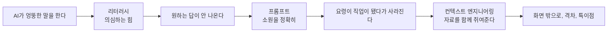

# 2강. AI 핵심 용어와 반짝 단어

![[images/aiax_ig_02_words.png|어려운 AI 말을 그림으로 풀어 본 사전]]

> [!question] 생각해 보기
> 2023년에는 "프롬프트 엔지니어, 억대 연봉"이라는 뉴스가 쏟아졌습니다. 지금 주변에 그 직함을 가진 사람이 있나요? 그 직업은 어디로 갔을까요?

## 0. 한 줄 흐름



각 단어는 "어디서 왔나 → 쉬운 비유 → 지금은?" 순서로 봅니다.

## 1. 문제: AI가 그럴듯하게 틀린다 → 리터러시

- **어디서 왔나**: 리터러시(Literacy)는 원래 "글을 읽고 쓰는 힘". 컴퓨터 리터러시 → 디지털 리터러시 → **AI 리터러시**로 이어졌습니다.
- **뜻**: AI와 대화하는 법, AI가 틀릴 때 알아채는 법을 아는 힘.
- AI가 사실이 아닌 것을 그럴듯하게 지어내는 현상을 **환각(Hallucination)** 이라 부릅니다.

> [!example] 생활 속 비유
> AI가 "고래는 하늘을 날아요"라고 해도 "어? 이상한데?" 하고 의심할 줄 아는 힘. 지니가 가끔 거짓 소원을 들어줄 때 알아채는 눈입니다.

## 2. 문제: 원하는 답이 안 나온다 → 프롬프트

- **어디서 왔나**: 연극에서 대사를 까먹은 배우에게 몰래 속삭여 주는 사람이 프롬프터(Prompter). 컴퓨터에서는 명령어 입력 자리. 지금은 **AI에게 하는 말 전체**를 프롬프트(Prompt)라 부릅니다.

> [!example] 생활 속 비유
> 지니에게 "과자 줘"보다 "초코 과자 세 개, 부서지지 않은 걸로"라고 해야 원하는 게 나옵니다.

> [!example] 바로 해 보기: 같은 일, 두 가지 소원
> 1. AI에 "소방 안전교육 자료 만들어줘"라고 입력합니다.
> 2. 새 대화에서 "초등 3학년 대상, 10분짜리 화재 대피 안전교육 대본. 질문 2개 포함, 쉬운 말"이라고 입력합니다.
> 3. 두 결과를 나란히 봅니다.
> 성공 확인: 두 번째가 바로 쓸 수 있는 수준이면 성공. 차이는 대상·분량·형식을 넣었느냐입니다.

> [!persona-field] 현장 대원이라면 이렇게 부탁해 보세요
> "야간 화재 출동을 마친 뒤 장비 점검 순서를 신규 대원용 체크리스트 10줄로 써줘. 장비 이름은 빈칸으로 두고, 꼭 확인할 것에는 별표를 붙여줘."

> [!persona-admin] 행정·사무라면 이렇게 부탁해 보세요
> "물품 구입 품의 초안을 1쪽으로 써줘. 품목·수량·금액은 빈칸으로 두고, 관련 근거 조항이 들어갈 자리를 표시해줘."

> [!persona-prev] 예방·안전이라면 이렇게 부탁해 보세요
> "아파트 관리소장에게 보낼 소방시설 자체점검 안내문을 300자로 써줘. 점검 기한과 미이행 시 불이익을 쉬운 말로 넣어줘."

> [!persona-general] 처음 배우는 분이라면 이렇게 부탁해 보세요
> "우리 집 화재 대피 계획을 가족 4명 기준으로 짜줘. 초등학생도 읽을 수 있게 짧은 문장으로 써줘."

## 3. 문제: 요령이 직업이 됐다가 사라진다 → 프롬프트 엔지니어의 흥망

| 단계 | 내용 |
|---|---|
| 등장 | 2022년 말 초기 AI는 말귀가 어두워 "단계별로 생각해봐" 한 줄로 답이 확 좋아지는 요령이 통함 |
| 반짝 | 2023년 3월 Anthropic의 프롬프트 엔지니어 공고에 연봉 최대 33만 5천 달러가 붙어 화제 |
| 시듦 | AI가 똑똑해져 대충 말해도 알아듣고, 요령이 다 알려져 모두의 기본기가 됨 |
| 지금 | **컨텍스트 엔지니어링**으로 이동. 주문 한 줄보다 어떤 자료·상황을 같이 쥐여주느냐가 중요 |

> [!example] 생활 속 비유
> 지니가 귀가 어두워 "지니 말 통역사"가 필요했는데, 지니가 보청기를 끼자 통역사가 할 일이 없어졌습니다.

## 4. 문제: 코딩을 몰라 만들지 못한다 → 노코드에서 바이브 코딩으로

- **노코드(No-code)**: 2010년대 블록을 끌어 붙여 앱을 만드는 도구(Bubble, Webflow 등)가 퍼지며 유행.
- **바이브 코딩(Vibe coding)**: 2025년 무렵부터 "이런 앱 만들어줘"라고 말하면 AI가 코드를 대신 짜는 방식이 그 자리를 차지.

> [!example] 생활 속 비유
> 집은 목수만 지었다 → 레고로 누구나 지었다 → 이제 "빨간 지붕 집 지어줘"라고 말하면 로봇이 레고를 조립합니다.

## 5. 기본 단어: 모델

- **어디서 왔나**: 모형 비행기처럼 진짜를 흉내 낸 것. 날씨 모델처럼 현상을 흉내 낸 계산식.
- **AI 모델**: 엄청난 글과 그림을 보고 "세상이 대충 이렇게 돌아가더라"를 흉내 내는 계산 덩어리.
- 서비스와 모델은 다릅니다. ChatGPT·Claude는 서비스, GPT-5·Claude Opus 5.5는 그 안의 모델. (3강에서 연표로)

## 6. 문제: AI가 화면 안에만 있다 → 피지컬 AI

- **피지컬 AI(Physical AI)**: 몸을 가진 AI. 로봇, 자율주행차, 드론이 여기에 들어갑니다. 2025년 초 엔비디아가 강조하며 크게 퍼진 말입니다.
- 소방에서는 드론, 정찰·소화 로봇이 해당합니다.

## 7. 문제: 쓰는 사람과 못 쓰는 사람이 벌어진다 → 격차

- **AI 격차(AI Divide)**: 1990년대 "디지털 격차"에서 이어진 말. AI를 잘 쓰는 사람·조직·나라와 못 쓰는 쪽의 차이.
- 리터러시와 짝꿍 단어입니다. 격차를 줄이는 방법이 리터러시 교육입니다.

## 8. 먼 이야기: 특이점

- **특이점(Singularity)**: 원래 물리학 용어로 기존 규칙이 깨지는 지점. 1993년 SF 작가 버너 빈지가 "AI가 사람보다 똑똑해지는 순간"에 붙였고, 레이 커즈와일이 2045년 무렵을 예측해 유명해졌습니다.
- 아직 오지 않았고, 온다·안 온다는 지금도 논쟁 중입니다.

## 9. 함께 반짝했다 시든 말들

| 단어 | 반짝했을 때 | 지금 |
|---|---|---|
| 프롬프트 엔지니어 | 2023년 억대 연봉 화제 | 모두의 기본기, 컨텍스트 엔지니어링으로 이동 |
| 노코드 | 2010년대 후반~2022 | 바이브 코딩에 자리 넘김 |
| 메타버스 | 2021년 페이스북이 사명을 메타로 변경 | AI 열풍에 밀려 조용해짐 (업계 평가) |
| AutoGPT | 2023년 4월 GitHub 트렌딩 1위 | 실제로는 산만해 식었다가 지금의 에이전트로 다시 태어남 |
| GPT 스토어 | 2024년 1월 출시, "AI 앱스토어" 기대 | 기대만큼 크지 않음 (업계 평가) |

> [!tip] 핵심
> AI가 빨리 똑똑해지면 "AI를 다루는 요령"으로 생긴 직업과 단어는 금방 사라집니다. 남는 것은 리터러시처럼 **판단하는 힘**입니다.

> [!example] 바로 해 보기: 반짝 단어 찾기
> 1. 3명이 한 조가 되어 최근 1년간 들은 AI 유행어 3개를 적습니다.
> 2. 각 단어를 "문제 → 해결" 문장으로 바꿔 봅니다. (예: 바이브 코딩 = 코딩을 몰라도 만들고 싶다 → 말로 시킨다)
> 성공 확인: 문제를 한 문장으로 못 쓰는 단어는 유행어일 가능성이 높습니다.

## 정리

### 1분 요약

리터러시는 의심하는 힘, 프롬프트는 소원을 정확히 비는 법. 프롬프트 엔지니어·노코드처럼 요령에서 나온 말은 AI가 똑똑해지면 사라지고, 판단하는 힘은 남습니다.

### 문제 → 해결책 짝 맞추기

| 문제 | 해결책(용어) |
|---|---|
| AI가 그럴듯하게 틀린다 | AI 리터러시 |
| 원하는 답이 안 나온다 | 프롬프트 (대상·분량·형식 명시) |
| 주문 한 줄로는 부족하다 | 컨텍스트 엔지니어링 |
| 코딩을 몰라 못 만든다 | 노코드 → 바이브 코딩 |
| AI가 화면 안에만 있다 | 피지컬 AI |
| 쓰는 사람만 앞서간다 | 격차 해소를 위한 리터러시 교육 |

### 이 단계에서 쓰는 도구

- 대화형 AI — 같은 일을 두 가지 프롬프트로 비교
- 검색 — AI 답의 사실 확인

### 셀프 체크

- [ ] 환각이 무엇인지 예를 들어 말할 수 있다
- [ ] 프롬프트에 넣을 요소 세 가지를 말할 수 있다
- [ ] 프롬프트 엔지니어가 시든 이유를 말할 수 있다
- [ ] 서비스 이름과 모델 이름을 구분한다

### AI에게 더 잘 요청하기

| 막연한 요청 | 용어를 넣은 요청 |
|---|---|
| 보고서 써줘 | 이 표(붙임)를 근거로, 과장 보고용 1쪽, 표 1개, 출처 없는 수치는 쓰지 마 |
| 이거 맞아? | 이 답에서 사실 확인이 필요한 문장만 골라 근거와 함께 표시해줘 |

### 더 찾아볼 곳

- [Bloomberg: 프롬프트 엔지니어 연봉 보도 (2023.3)](https://www.bloomberg.com/news/articles/2023-03-29/ai-chatgpt-related-prompt-engineer-jobs-pay-up-to-335-000)
- [Wikipedia: AutoGPT](https://en.wikipedia.org/wiki/AutoGPT)
- [AP/OPB: 페이스북, 메타로 사명 변경 (2021.10)](https://opb.org/article/2021/10/28/facebook-rebrands-as-meta-to-emphasize-metaverse-vision)

```quiz
{"title":"2강 확인 퀴즈","questions":[
{"q":"AI가 사실이 아닌 내용을 그럴듯하게 지어내는 현상은?","options":["특이점","환각","격차","추론"],"answer":1,"explain":"환각(Hallucination)을 알아채는 힘이 리터러시입니다."},
{"q":"프롬프트 엔지니어라는 직함이 시든 이유로 가장 알맞은 것은?","options":["법으로 금지되어서","AI가 똑똑해져 요령이 모두의 기본기가 되어서","연봉이 너무 낮아서","인터넷이 끊겨서"],"answer":1,"explain":"지금은 자료와 상황을 함께 주는 컨텍스트 엔지니어링으로 관심이 옮겨갔습니다."},
{"q":"말로 설명하면 AI가 코드를 대신 짜 주는 방식은?","options":["노코드","바이브 코딩","전문가 시스템","메타버스"],"answer":1,"explain":"바이브 코딩이 노코드의 자리를 이어받았습니다."},
{"q":"로봇·드론·자율주행차처럼 몸을 가진 AI는?","options":["피지컬 AI","생성형 AI","오픈 모델","GPT 스토어"],"answer":0,"explain":"화면 밖에서 실제로 움직이는 AI입니다."},
{"q":"리터러시와 짝꿍인 단어로, 쓰는 사람과 못 쓰는 사람의 차이를 뜻하는 것은?","options":["특이점","격차","환각","모델"],"answer":1,"explain":"격차를 줄이는 방법이 리터러시 교육입니다."}
]}
```
