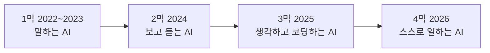

# 3강. 생성형 AI 모델 연표 (2022.11~2026.10)

![[images/aiax_ig_03_timeline.png|말하는 아기에서 심부름하는 비서까지, AI의 네 막]]

> [!question] 생각해 보기
> 2년 전 쓰던 스마트폰과 지금 스마트폰은 얼마나 다른가요? AI 모델은 같은 기간에 몇 번 바뀌었을까요?

## 0. 한 줄 흐름



![[images/aiax_timeline_2022-2026.png|회사별 주요 모델 출시 시점 (기준일 2026.10.15)]]

ChatGPT 이후 4년 동안 AI는 네 번 모습을 바꿨습니다. 각 막은 앞 막의 한계를 푼 결과입니다.

## 1. 1막: 말하는 AI (2022.11~2023)

> [!tip] 핵심
> 누구나 AI와 대화하게 된 시기. 문제는 "글만 안다"는 것.

| 시기 | 회사 | 모델 | 새로웠던 점 |
|---|---|---|---|
| **2022.11.30** | OpenAI | **ChatGPT (GPT-3.5)** | 대화형 AI 대중화의 시작 |
| 2023.02 | Meta | LLaMA | 설계도 공개 → 오픈 모델 시대 |
| **2023.03.14** | OpenAI | **GPT-4** | 사진 이해, 시험 상위권 수준 |
| 2023.03.14 | Anthropic | Claude 1 | 안전성을 내세운 첫 Claude |
| 2023.08 | 네이버 | HyperCLOVA X | 한국어 특화 국산 모델 |
| 2023.12 | Google | Gemini 1.0 | 글·그림·소리를 함께 배운 모델 |

## 2. 2막: 보고 듣는 AI (2024)

> [!tip] 핵심
> **멀티모달(Multimodal)**: 그림·소리·영상까지 이해. 그리고 **추론 모델**이 처음 등장.

| 시기 | 회사 | 모델 | 새로웠던 점 |
|---|---|---|---|
| 2024.03 | Anthropic | Claude 3 (Opus·Sonnet·Haiku) | 큰·중간·작은 3종 구성 |
| **2024.05** | OpenAI | **GPT-4o** | 실시간 음성 대화 |
| 2024.06 | Anthropic | Claude 3.5 Sonnet | 코딩 실력 급상승 |
| **2024.09** | OpenAI | **o1** | 답하기 전에 생각하는 첫 추론 모델 |
| 2024.10 | Anthropic | 컴퓨터 사용 기능 | AI가 마우스·키보드로 컴퓨터 조작 |
| 2024.12 | DeepSeek | DeepSeek-V3 | 중국의 저비용 고성능 모델 |

## 3. 3막: 생각하고 코딩하는 AI (2025)

> [!tip] 핵심
> 저비용 충격과 **AI 코딩** 시대. AI가 몇 시간씩 혼자 프로그램을 짜기 시작.

| 시기 | 회사 | 모델 | 새로웠던 점 |
|---|---|---|---|
| **2025.01.20** | DeepSeek | **DeepSeek-R1** | 적은 비용으로 o1급 성능, 세계 주가 출렁 |
| 2025.02 | Anthropic | Claude 3.7 Sonnet + Claude Code | 터미널에서 코딩하는 에이전트 도구 |
| 2025.05 | Anthropic | Claude 4 | 장시간 자율 코딩 |
| 2025.08 | 한국 정부 | 독자 AI 파운데이션 모델 사업 착수 | 국가대표 AI 육성 |
| **2025.08.07** | OpenAI | **GPT-5** | 빠른 답·깊은 생각 자동 전환 |
| 2025.11 | Google / Anthropic | Gemini 3, Claude Opus 4.5 | 최상위권 경쟁 |

## 4. 4막: 스스로 일하는 AI, 에이전트 (2026.01~10)

> [!important] 이 강의의 핵심
> 2026년에는 한두 달마다 새 모델이 나왔습니다. 키워드는 **에이전트, 보안, 가격 하락, 100만 토큰 기억력**.

| 날짜 | 회사 | 모델 | 새로웠던 점 |
|---|---|---|---|
| 2026.02.05 | Anthropic | Claude Opus 4.6 | 100만 토큰 컨텍스트 |
| 2026.02.19 | Google | Gemini 3.1 Pro | 어려운 추론 성능 대폭 향상 |
| **2026.04.07** | Anthropic | **Claude Mythos Preview** | 보안 취약점 탐지 능력이 너무 강해 일반 공개 대신 소수 협력기관에만 제공 (Project Glasswing) |
| 2026.04.08 | Meta | Muse Spark | Llama 대신 새 이름 |
| **2026.04.23** | OpenAI | **GPT-5.5** | 에이전트 코딩 강화 |
| 2026.04.24 | DeepSeek | DeepSeek V4 | 100만 토큰 기본, 저가 오픈 모델 |
| **2026.06.09** | Anthropic | **Claude Fable 5 / Mythos 5** | Mythos급 모델 첫 일반 공개 (Fable은 안전장치 추가판) |
| 2026.07.09 | OpenAI | GPT-5.6 | 크기별 3종 |
| 2026.08.18 | 한국 정부 | 독파모 2차 평가 | LG·SKT·업스테이지 통과 |
| **2026.09.22** | Anthropic | **Claude Opus 5.5** | 상위 성능을 더 싼 가격에 |
| 2026.09.28 | Anthropic | Claude Sonnet 5.5 | 더 빠른 중형 모델 |
| **2026.10.07** | OpenAI | **GPT-6** | 답변 안에 차트·버튼·계산기가 들어가는 화면 |

> [!info] 아직 나오지 않은 것 (2026.10.15 기준)
> Google Gemini 4(연내 예고), xAI Grok 5(학습 중). 강의 직전 다시 확인합니다.

### 2026년의 다섯 가지 흐름

1. **에이전트**: 대답하는 AI에서 몇 시간씩 혼자 일하는 AI로
2. **보안**: 너무 강해서 공개를 제한하는 모델까지 등장
3. **가격 하락**: 더 싸고 빠른 고성능 모델
4. **긴 기억력**: 100만 토큰(책 여러 권)을 한 번에 읽는 것이 기본
5. **나라별 경쟁**: 미국 대 중국, 한국은 독자 AI 파운데이션 모델

> [!example] 바로 해 보기: 내가 쓰는 AI는 몇 막인가
> 1. 지금 쓰는 AI 서비스를 열고 "너는 어떤 모델이야?"라고 묻거나 화면의 모델 선택 메뉴를 확인합니다.
> 2. 위 표에서 그 모델을 찾아 몇 막인지 표시합니다.
> 3. 같은 회사의 최신 모델과 출시일 차이를 계산합니다.
> 성공 확인: 내가 쓰는 모델이 최신에서 몇 개월 뒤처졌는지 말할 수 있으면 성공.

## 5. 회사별 한눈에 보기

| 회사 | 서비스 | 2022 → 2026 흐름 |
|---|---|---|
| OpenAI | ChatGPT | GPT-3.5 → 4 → 4o → o1 → 5 → 5.5 → 6 |
| Anthropic | Claude | Claude 1 → 3 → 3.5 → 4 → 4.5~4.8 → Fable·Mythos 5 → Opus·Sonnet·Haiku 5.5 |
| Google | Gemini | Bard → Gemini 1.0 → 2.5 → 3 → 3.1 → 3.5 Flash |
| Meta | Meta AI | LLaMA → Llama 4 → Muse Spark |
| 중국 | DeepSeek, Kimi | DeepSeek-V3 → R1 → V4 / Kimi K2 → K3 |
| 한국 | 클로바X, 엑사원 등 | HyperCLOVA X → EXAONE → 독파모 |

> [!example] 생활 속 비유
> - 2022년 AI: 말을 막 배운 아기. 대답은 잘하는데 가끔 엉뚱함
> - 2024년 AI: 눈과 귀가 생긴 어린이
> - 2025년 AI: 문제를 풀기 전에 생각하는 학생
> - 2026년 AI: 심부름을 맡기면 혼자 계획해 끝내는 비서. 다음 4~6강은 이 비서를 부리는 법입니다

## 정리

### 1분 요약

말하는 AI(2022) → 보고 듣는 AI(2024) → 생각하고 코딩하는 AI(2025) → 스스로 일하는 AI(2026). 모델은 매달 바뀌므로 이름을 외우기보다 "몇 막인가"로 위치를 잡습니다.

### 문제 → 해결책 짝 맞추기

| 문제 | 해결책 |
|---|---|
| 글만 이해한다 | 멀티모달 (GPT-4o, Gemini) |
| 바로 답해서 틀린다 | 추론 모델 (o1 이후) |
| 비싸다 | 저비용 모델 (DeepSeek-R1, Opus 5.5) |
| 긴 자료를 못 읽는다 | 100만 토큰 컨텍스트 |
| 대답만 하고 일은 못 한다 | 에이전트 (Claude Code 등) |

### 이 단계에서 쓰는 도구

- 각 서비스의 모델 선택 메뉴, 공식 발표 페이지

### 셀프 체크

- [ ] 4막의 이름을 순서대로 말할 수 있다
- [ ] 첫 추론 모델과 출시 시기를 말할 수 있다
- [ ] Mythos Preview가 일반 공개되지 않은 이유를 말할 수 있다
- [ ] 내가 쓰는 모델이 몇 막인지 안다

### AI에게 더 잘 요청하기

| 막연한 요청 | 용어를 넣은 요청 |
|---|---|
| 요즘 AI 뭐가 좋아? | 문서 요약·표 작성 업무 기준으로, 추론 모델과 일반 모델 중 무엇이 맞는지 이유와 함께 |
| 최신 모델 알려줘 | 오늘 기준 공식 발표된 모델만, 발표일과 출처 링크 포함 |

### 더 찾아볼 곳

- [Wikipedia: 2022 in artificial intelligence](https://en.wikipedia.org/wiki/2022_in_artificial_intelligence)
- [Anthropic Project Glasswing](https://www.anthropic.com/glasswing)
- [독자 AI 파운데이션 모델 2차 평가 결과 (바이라인네트워크)](https://byline.network/2026/08/0818-7/)
- [2026년 모델 출시 목록 (BridgeBench)](https://www.bridgebench.ai/blog/ai-coding-model-releases-2026)

> [!warning] 강사 메모
> 날짜는 공식 발표 또는 주요 보도의 첫 공개일 기준입니다. 모델은 매달 바뀌므로 강의 전날 최신 출시를 다시 확인하고 표를 고칩니다.

```quiz
{"title":"3강 확인 퀴즈","questions":[
{"q":"대화형 AI 대중화의 시작이 된 서비스와 출시 시기는?","options":["GPT-4, 2023년 3월","ChatGPT, 2022년 11월","Gemini, 2023년 12월","Claude, 2023년 3월"],"answer":1,"explain":"2022년 11월 30일 ChatGPT가 1막을 열었습니다."},
{"q":"답하기 전에 속으로 생각하는 첫 추론 모델은?","options":["GPT-4o","o1","LLaMA","Claude 3"],"answer":1,"explain":"OpenAI o1, 2024년 9월입니다."},
{"q":"적은 비용으로 고성능을 내 2025년 1월 세계를 놀라게 한 모델은?","options":["DeepSeek-R1","Muse Spark","GPT-5","HyperCLOVA X"],"answer":0,"explain":"DeepSeek-R1이 3막의 저비용 충격입니다."},
{"q":"보안 능력이 너무 강해 일반 공개 대신 소수 기관에만 제공된 모델은?","options":["Claude Sonnet 5.5","GPT-6","Claude Mythos Preview","Gemini 3.1 Pro"],"answer":2,"explain":"Project Glasswing을 통해 제한 제공되었습니다."},
{"q":"2026년(4막)의 핵심 키워드가 아닌 것은?","options":["에이전트","가격 하락","100만 토큰","전문가 시스템"],"answer":3,"explain":"전문가 시스템은 1980년대 방식입니다."}
]}
```
