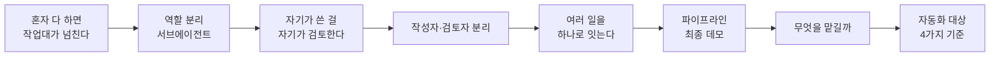
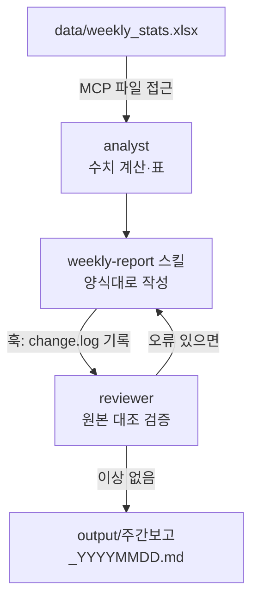

# 6강. 멀티에이전트와 업무 자동화 데모

![[images/aiax_ig_06_team.png|쓴 지니와 검사하는 지니는 따로]]

> [!question] 생각해 보기
> 보고서를 쓴 사람이 자기 보고서를 검토하면 오류를 잘 찾을까요? 결재 라인에 검토자가 따로 있는 이유는 무엇일까요?

## 0. 한 줄 흐름



## 1. 문제: 혼자 다 하면 작업대가 넘친다 → 멀티에이전트

| 단일 에이전트 | 멀티에이전트 |
|---|---|
| 컨텍스트 하나에 모든 작업 누적 | 역할별 독립 컨텍스트 |
| 자기가 만든 걸 자기가 검토 | 작성자와 검토자 분리 |
| 순서대로 처리 | 동시에 처리 가능 |

**대표 패턴 세 가지**

1. **순차형(파이프라인)**: 수집 → 분석 → 작성 → 검토
2. **병렬형(팬아웃)**: 여러 파일·주제를 동시에 처리한 뒤 모음
3. **검토형(평가자)**: 작성 에이전트 + 독립 검토 에이전트

> [!example] 생활 속 비유
> 지니 한 명에게 다 시키지 않고, 계산 담당 지니와 검토 담당 지니를 따로 둡니다. 결재 라인과 같습니다.

## 2. 해결: 역할이 다른 서브에이전트 만들기

`.claude/agents/analyst.md`

```markdown
---
name: analyst
description: 엑셀·CSV 데이터 분석 전담. 수치 계산과 표 작성이 필요할 때 사용.
tools: Read, Bash, Write
---
너는 데이터 분석가다. 계산은 반드시 파이썬으로 실행해 검증하고,
결과는 output/analysis.md에 표로 저장한다. 해석은 하지 않는다.
```

`.claude/agents/reviewer.md`

```markdown
---
name: reviewer
description: 산출물 검토 전담. 보고서 완성 후 수치·형식 오류 확인 시 사용.
tools: Read, Bash
---
너는 검토자다. 원본 데이터와 보고서 수치를 대조하고
오류 목록만 보고한다. 파일을 직접 수정하지 않는다.
```

> [!tip] 설계 원칙
> - 역할은 하나, 도구는 최소로
> - **검토자에게는 쓰기 권한을 주지 않는다** (tools에 Write·Edit 없음)
> - `/agents` 명령으로 목록 확인과 생성도 할 수 있다

## 3. 해결: 하나의 지시로 파이프라인 돌리기 (최종 데모)



메인 에이전트에게 한 번에 지시합니다.

```
1) analyst 서브에이전트로 data/weekly_stats.xlsx를 분석하고
2) weekly-report 스킬로 보고서를 작성한 뒤
3) reviewer 서브에이전트로 검토해서
오류가 있으면 고친 최종본을 output/에 저장해줘
```

> [!example] 바로 해 보기: 오류 잡는 장면 보기
> 1. 실습 폴더의 `data/weekly_stats.xlsx`에는 마센터 합계가 일부러 틀려 있습니다(30, 정답 27).
> 2. 위 지시를 실행합니다.
> 3. reviewer의 오류 보고, 수정된 최종본, `output/change.log`의 훅 기록을 차례로 엽니다.
> 성공 확인: 검토자가 틀린 행을 찾아내고 최종본에서 고쳐졌으면 성공.

**심화(선택)**: `git worktree add ../agent-lab-b -b feature-b`로 작업 폴더를 나눠 에이전트 두 개를 동시에 돌립니다.

## 4. 문제: 무엇을 맡길까 → 자동화 대상 4가지 기준

| 기준 | 질문 | 맡겨도 됨 |
|---|---|---|
| 반복성 | 주 1회 이상 하는가 | 예 |
| 규칙성 | 절차를 문장으로 쓸 수 있는가 | 예 |
| 검증성 | 결과가 맞는지 확인할 수 있는가 | 예 |
| 복구성 | 실수해도 되돌릴 수 있는가 | 예 |

네 가지가 모두 "예"인 업무부터 시작합니다. 하나라도 "아니오"면 사람이 최종 판단합니다.

> [!example] 바로 해 보기: 내 업무 고르기
> 1. 이번 주 내가 한 일 5개를 적습니다.
> 2. 위 4가지 기준으로 O·X를 표시합니다.
> 3. 네 개 모두 O인 업무 1개로 SKILL.md 초안을 5줄로 씁니다.
> 성공 확인: 1~2명이 발표할 수 있으면 성공. 활용편에서 이어 갑니다.

> [!persona-field] 현장 대원이라면 이런 일부터
> 매일 아침 장비 점검표 취합 (반복 O, 규칙 O, 검증 O, 복구 O) → 스킬 1개로 시작

> [!persona-admin] 행정·사무라면 이런 일부터
> 매월 지출집행현황 엑셀로 집행률 보고 (반복 O, 규칙 O, 검증 O, 복구 O) → 분석·작성·검토 파이프라인

> [!persona-prev] 예방·안전이라면 이런 일부터
> 자체점검 결과 접수 목록 정리 (반복 O, 규칙 O, 검증 O, 복구 O) → 스킬 1개로 시작. 위반 판정은 사람이 합니다

> [!persona-general] 처음 배우는 분이라면 이런 일부터
> 매주 하는 가계부 정리 (반복 O, 규칙 O, 검증 O, 복구 O) → 대화형 AI에 같은 지시문을 저장해 두고 반복

## 정리

### 1분 요약

역할을 나누고 검토자는 따로 둔다(쓰기 권한 없이). MCP·스킬·훅·서브에이전트를 이으면 지시 한 줄로 분석 → 작성 → 검토가 끝난다. 반복·규칙·검증·복구 가능한 일부터 맡긴다.

### 문제 → 해결책 짝 맞추기

| 문제 | 해결책 |
|---|---|
| 한 작업대에 모든 일이 쌓인다 | 서브에이전트로 역할 분리 |
| 자기 검토로 오류를 못 찾는다 | 쓰기 권한 없는 reviewer |
| 단계마다 사람이 지시한다 | 파이프라인 지시 한 번 |
| 무엇부터 자동화할지 모른다 | 반복·규칙·검증·복구 4기준 |

### 이 단계에서 쓰는 도구

- `.claude/agents/*.md`, `/agents`, git worktree

### 셀프 체크

- [ ] 멀티에이전트 패턴 세 가지를 말할 수 있다
- [ ] 검토자에게 쓰기 권한을 주지 않는 이유를 말할 수 있다
- [ ] 최종 데모의 흐름을 그림 없이 설명할 수 있다
- [ ] 내 업무 1개를 4기준으로 판정했다

### AI에게 더 잘 요청하기

| 막연한 요청 | 용어를 넣은 요청 |
|---|---|
| 검토도 해줘 | 읽기 전용 reviewer 서브에이전트로 원본과 수치를 대조하고 오류 목록만 보고해 |
| 이 일 자동화해줘 | 이 업무가 반복·규칙·검증·복구 기준을 통과하는지 먼저 판정하고, 통과하면 스킬 초안을 써줘 |

### 더 찾아볼 곳

- [Claude Code 서브에이전트 문서](https://docs.claude.com/en/docs/claude-code/sub-agents)
- [Anthropic: Building effective agents](https://www.anthropic.com/research/building-effective-agents)

```quiz
{"title":"6강 확인 퀴즈","questions":[
{"q":"멀티에이전트의 장점이 아닌 것은?","options":["역할별 독립 컨텍스트","작성자와 검토자 분리","병렬 처리","검토 없이 바로 확정"],"answer":3,"explain":"멀티에이전트는 오히려 검토를 분리해 강화합니다."},
{"q":"reviewer 서브에이전트의 tools에서 빼야 하는 것은?","options":["Read","Bash","Write","모두 필요"],"answer":2,"explain":"검토자는 고치지 않고 보고만 해야 합니다."},
{"q":"수집→분석→작성→검토 순서로 잇는 패턴은?","options":["순차형(파이프라인)","병렬형(팬아웃)","검토형(평가자)","단일형"],"answer":0,"explain":"단계를 차례로 잇는 것이 파이프라인입니다."},
{"q":"자동화 대상 4가지 기준이 아닌 것은?","options":["반복성","규칙성","검증성","화려함"],"answer":3,"explain":"반복성·규칙성·검증성·복구성입니다."},
{"q":"최종 데모에서 오류를 일부러 1건 넣는 이유는?","options":["파일 크기를 키우려고","검토자가 오류를 잡는 장면을 보여주려고","속도를 높이려고","훅을 끄려고"],"answer":1,"explain":"작성자·검토자 분리의 효과를 눈으로 확인합니다."}
]}
```
