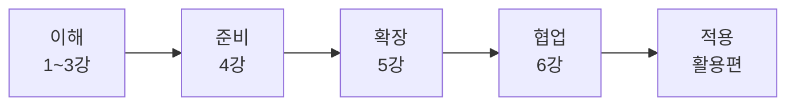

# 복습. 1~6강 한 장 정리

## 1. 한 장 요약표

| 강 | 핵심 질문 | 한 줄 답 | 지니 비유 |
|---|---|---|---|
| 1강 | AI는 어디서 왔나 | 튜링 질문 → 두 번의 겨울 → 딥러닝 → 말하는 AI | 지니의 탄생 |
| 2강 | 어떻게 말하고 무엇을 경계하나 | 리터러시로 의심하고, 프롬프트로 정확히 | 소원 비는 법 |
| 3강 | 지금 어디까지 왔나 | 말하는 → 보고 듣는 → 생각하는 → 일하는 AI | 지니의 세대교체 |
| 4강 | 일을 맡기려면 무엇을 준비하나 | CLAUDE.md, 권한, 지시 4요소, 계획 모드 | 업무 수첩 |
| 5강 | 손발·매뉴얼·규칙은 | MCP·스킬·훅 | 손발·매뉴얼·강제 규칙 |
| 6강 | 일 하나를 끝까지 끝내려면 | 역할 분리 + 검토자 분리 + 파이프라인 | 지니 팀 |

## 2. 전 강의 짝 맞추기

| 문제 | 해결책 | 강 |
|---|---|---|
| 규칙을 다 적을 수 없다 | 머신러닝 | 1 |
| 긴 문장의 맥락을 놓친다 | 트랜스포머 | 1 |
| AI가 그럴듯하게 틀린다 | 리터러시 | 2 |
| 원하는 답이 안 나온다 | 프롬프트, 컨텍스트 엔지니어링 | 2 |
| 바로 답해서 틀린다 | 추론 모델 | 3 |
| 대답만 하고 일은 못 한다 | 에이전트 | 3, 4 |
| 매번 규칙을 설명한다 | CLAUDE.md | 4 |
| 엉뚱한 결과 | 지시 4요소 (목표·맥락·제약·완료 기준) | 4 |
| 외부 자료에 손이 안 닿는다 | MCP | 5 |
| 반복 업무를 매번 설명한다 | 스킬 | 5 |
| 규칙을 어긴다 | 훅 | 5 |
| 자기 검토로 오류를 못 찾는다 | 쓰기 권한 없는 검토 에이전트 | 6 |

## 3. 오해 바로잡기

| 오해 | 바로잡기 |
|---|---|
| AI는 최근에 갑자기 생겼다 | 1956년에 이름이 붙었고, 70년 동안 겨울과 봄을 반복했다 |
| 프롬프트 요령만 알면 된다 | 요령은 금방 낡는다. 남는 것은 판단력과 자료를 주는 능력 |
| 최신 모델 이름을 외워야 한다 | 매달 바뀐다. "몇 막인가"로 위치만 잡는다 |
| 에이전트는 알아서 다 해 준다 | 규칙(CLAUDE.md)·권한·완료 기준을 줘야 제대로 한다 |
| 스킬과 훅은 같은 것이다 | 스킬은 에이전트가 골라 쓰고, 훅은 시스템이 무조건 실행한다 |
| 검토도 같은 에이전트가 하면 된다 | 작성자와 검토자를 나눠야 오류를 잡는다 |
| 아무 업무나 자동화하면 된다 | 반복·규칙·검증·복구 4기준을 통과한 업무부터 |

## 4. 셀프 체크

- [ ] AI의 겨울이 온 이유를 말할 수 있다
- [ ] 리터러시와 격차의 관계를 말할 수 있다
- [ ] 2022~2026년 4막을 순서대로 말할 수 있다
- [ ] 지시 4요소로 지시문을 쓸 수 있다
- [ ] MCP·스킬·훅을 비유로 구분할 수 있다
- [ ] 검토자에게 쓰기 권한을 주지 않는 이유를 안다
- [ ] 자동화 대상 4기준을 말할 수 있다

> [!tip] 다음
> [[AIAX_95_활용편|활용편]]에서 내 업무 하나를 골라 실제로 맡길 설계도를 만듭니다.
