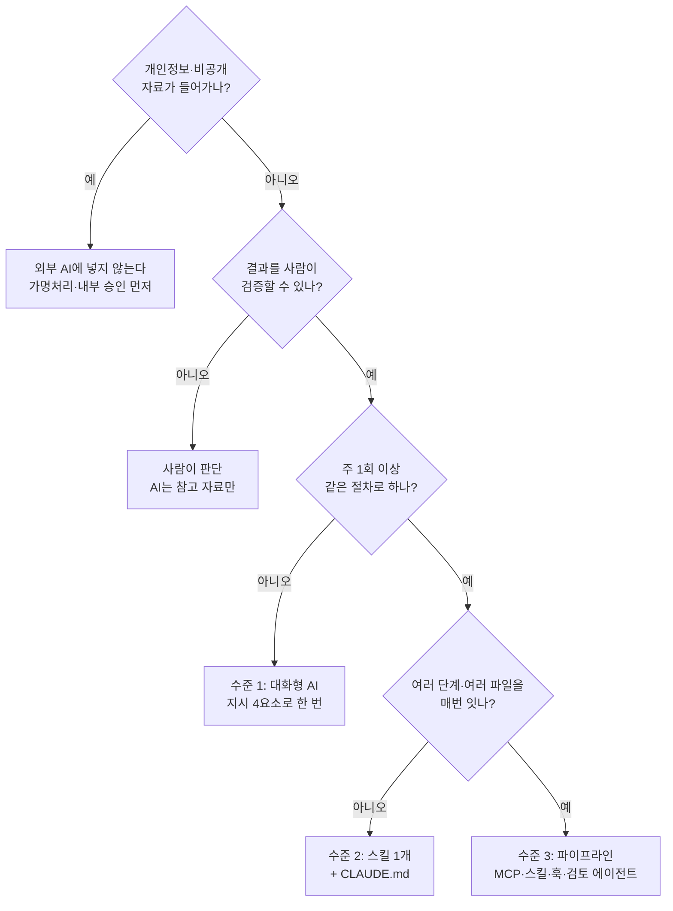

# 활용편. 이제 무엇을 맡길까

![[images/aiax_ig_95_apply.png|질문 두 개로 빨강·노랑·초록을 고릅니다]]

> [!question] 생각해 보기
> 지난 한 달 동안 "이건 매번 똑같은데 누가 대신 해 주면 좋겠다"라고 생각한 일이 있었나요? 하나만 떠올려 두세요. 이 시간이 끝나면 그 일을 AI에게 맡길 설계도 한 장이 손에 남습니다.

## 0. 한 줄 흐름


1~6강에서 배운 것은 외우는 지식이 아니라 **"이 일을 AI에게 맡겨도 되는가, 어느 수준으로 맡길까"를 재는 자**입니다.

## 1. 배운 것은 어디에 쓰이나

| 배운 것 | 강의 속 비유 | 업무에서의 쓰임 | 소방 업무 예시 |
|---|---|---|---|
| 리터러시 (2강) | 거짓 소원 알아채기 | AI 답의 사실 확인 | 법령 조문·수치가 맞는지 원문 대조 |
| 프롬프트 4요소 (4강) | 소원을 정확히 | 한 번에 쓸 만한 초안 | 화재 예방 홍보문, 안전교육 대본 |
| CLAUDE.md (4강) | 업무 수첩 | 부서 규칙을 매번 안 말해도 됨 | 공문 서식·용어 규칙 고정 |
| MCP (5강) | 손발 | 공유폴더·드라이브 자료 읽기 | 점검 결과 엑셀을 바로 읽어 집계 |
| 스킬 (5강) | 업무 매뉴얼 | 반복 문서를 같은 양식으로 | 주간 출동통계 보고, 구입 품의 초안 |
| 훅 (5강) | 강제 규칙 | 실수 방지 | 원본 대장 삭제·덮어쓰기 차단 |
| 검토 에이전트 (6강) | 결재 라인 | 수치·형식 오류 잡기 | 예산 집행률 보고서 합계 검증 |

> [!tip] 핵심
> 대부분의 업무는 **가장 단순한 방법(대화형 AI + 좋은 지시)으로 충분합니다.** 스킬은 같은 일을 주 1회 이상 할 때, 파이프라인은 여러 단계를 매번 이어서 할 때만 씁니다. 단순할수록 빨리 만들고 보안 걱정도 줄어듭니다.

## 2. 내 상황은 어디에 해당하나



기억할 질문 세 개:

1. **넣어도 되나?** 개인정보·비공개 자료가 있으면 멈춘다.
2. **확인할 수 있나?** 결과를 검증할 수 없으면 사람이 판단한다.
3. **얼마나 자주, 몇 단계인가?** 가끔이면 대화, 자주면 스킬, 자주+여러 단계면 파이프라인.

> [!example] 바로 해 보기: 판별 연습
> 아래 세 업무는 각각 어느 수준일까요?
> - (가) 다음 달 한 번 있는 소방안전 캠페인 홍보 문구 작성
> - (나) 매주 월요일 출동 통계 엑셀로 주간 보고서 작성
> - (다) 매월 지출집행현황 엑셀 → 세부사업별 집행률 계산 → 보고서 → 합계 검증
>
> 정답: (가) 수준 1 대화형 AI · (나) 수준 2 스킬 · (다) 수준 3 파이프라인(분석·작성·검토 분리)

> [!persona-field] 현장 대원의 첫 과제 예시
> 출동 후 장비 점검 체크리스트 만들기 → 초록불, 수준 1(대화형 AI). 실제 차량번호·대원 이름은 넣지 않습니다.

> [!persona-admin] 행정·사무의 첫 과제 예시
> 월간 집행률 보고서 → 초록불, 수준 3(분석·작성·검토). 예산 엑셀은 금액을 바꾼 가짜 파일로 먼저 시험합니다.

> [!persona-prev] 예방·안전의 첫 과제 예시
> 자체점검 안내문 대상별 문구 만들기 → 초록불, 수준 2(스킬). 대상물 주소·관계인 이름은 넣지 않습니다.

> [!persona-general] 처음 배우는 분의 첫 과제 예시
> 우리 집 화재 대피 계획 → 초록불, 수준 1(대화형 AI). 결과를 가족과 함께 소리 내어 읽어 보며 확인합니다.

## 3. 아이디어가 생기면: 실행 단계

| 단계 | 할 일 | 산출물 | 시간 |
|---|---|---|---|
| 1 불편 적기 | 반복되는 일, 실수 나는 일, 남에게 묻는 일을 적는다 | 메모 3줄 | 5분 |
| 2 한 문장 정의 | "누가 / 무엇을 넣으면 / 무엇이 나온다" | 문장 1개 | 5분 |
| 3 판정 | 위 흐름도로 수준 1·2·3 중 하나를 정한다 | 수준 표시 | 2분 |
| 4 계획 1장 | 입력, 출력, 절차, 완료 기준, 금지 사항을 적는다 | 설계도 1장 | 20분 |
| 5 실행 | 수준에 맞게 지시문·SKILL.md·에이전트를 만든다 | 첫 버전 | 30분 |
| 6 동료 피드백 | 옆자리 1명에게 써 보게 하고 막힌 곳을 적는다 | 고칠 목록 | 15분 |
| 7 공유·개선 | 부서에 공유하고 받은 의견으로 고친다 | v2, v3 | 반복 |

> [!warning] 시작하기 전에 꼭 확인
> - **실제 개인정보·내부 문서는 외부 AI에 넣지 않는다.** 가짜 예시 데이터로 만들고, 실데이터는 기관 보안 정책을 따른다.
> - 부서 공용으로 쓰려면 **상급자와 정보보안 담당자에게 먼저 보고·승인**을 받는다.
> - 비밀번호·API 키를 CLAUDE.md나 코드에 적지 않는다.
> - 업무 중 만든 도구는 **직무발명**에 해당할 수 있다. 특허를 생각한다면 공개 전에 기관 절차를 확인한다.
> - AI 결과물은 초안이다. 결재·대외 발송 전 최종 확인은 사람이 한다.

## 4. 아이디어 설계기

빈칸을 채우면 신호등과 수준을 판정하고, 설계도와 AI에게 보낼 요청문을 만들어 줍니다. 결과를 복사해 Claude에 그대로 붙여 넣으세요.

```idea-lab
{"examples":[
 {"name":"안전교육 대본 생성","who":"119안전센터 안전교육 담당자","pain":"대상(유치원·노인·학생)이 바뀔 때마다 교육 대본을 처음부터 다시 쓴다","input":"교육 대상, 시간, 주제","output":"대상 눈높이에 맞춘 교육 대본과 확인 질문 3개","secret":"no","verify":"yes","freq":"often","steps":"one"},
 {"name":"월간 집행률 보고","who":"소방서 예산 담당자","pain":"매달 지출집행현황 엑셀을 손으로 집계하고 합계를 다시 맞춘다","input":"지출집행현황 엑셀(가짜 데이터로 시험)","output":"세부사업별 집행률 표와 보고서 초안, 합계 검증 결과","secret":"no","verify":"yes","freq":"weekly","steps":"many"}
]}
```

## 5. 더 잘 요청하기·실행하기

| 막연한 시작 | 배운 것을 넣은 시작 |
|---|---|
| AI로 업무 자동화해 보고 싶어 | 이 업무가 반복·규칙·검증·복구 4기준을 통과하는지 먼저 판정해줘 |
| 보고서 자동으로 만들어줘 | 목표: 월간 집행률 1쪽 / 맥락: 가짜 예시 엑셀 / 제약: 표 1개, 원본 수정 금지 / 완료 기준: 합계 검증 결과 보고 |
| 매번 같은 걸 시키기 귀찮아 | 이 절차를 SKILL.md로 만들어줘. description은 "월간 집행률 보고 요청 시 사용" |
| 틀릴까 봐 걱정돼 | 쓰기 권한 없는 reviewer 서브에이전트로 원본과 대조해 오류 목록만 보고해 |
| 실수로 원본 지울까 봐 | data/ 삭제·이동을 막는 PreToolUse 훅과 테스트 방법을 만들어줘 |

## 6. 다음 학습 경로


| 단계 | 목표 | 첫 과제 | 연결 강의 |
|---|---|---|---|
| 1 | AI 답을 의심하며 쓰기 | 업무 질문 하루 3개, 답 1개씩 원문 대조 | [[AIAX_02_AI핵심용어\|2강]] |
| 2 | 반복 문서 하나 고정 | 내 업무용 CLAUDE.md + SKILL.md 1개 | [[AIAX_04_에이전트환경과지시설계\|4강]], [[AIAX_05_MCP스킬훅\|5강]] |
| 3 | 자료 연결과 실수 방지 | 파일 MCP 연결, 원본 보호 훅 | [[AIAX_05_MCP스킬훅\|5강]] |
| 4 | 끝까지 맡기기 | 분석·작성·검토 3단 파이프라인 1개 | [[AIAX_06_멀티에이전트와업무자동화\|6강]] |

## 7. 정리

### 1분 요약

먼저 "넣어도 되나, 확인할 수 있나"를 묻고, 가끔 하는 일은 대화형 AI로, 자주 하는 일은 스킬로, 여러 단계를 매번 잇는 일만 파이프라인으로. 대부분은 가장 단순한 방법으로 충분하다.

### 셀프 체크

- [ ] 내 업무 1개를 흐름도로 판정했다
- [ ] 한 문장 정의("누가 / 무엇을 넣으면 / 무엇이 나온다")를 썼다
- [ ] 설계기로 설계도와 요청문을 만들었다
- [ ] 개인정보·보안·보고 절차를 확인했다

> [!todo] 오늘의 과제
> 이번 주 안에 판정한 업무 1개를 가짜 예시 데이터로 실제 AI에게 맡겨 첫 버전을 만들고, 동료 1명에게 보여 줍니다.

```quiz
{"title":"활용편 확인 퀴즈","questions":[
{"q":"AI에게 업무를 맡기기 전 가장 먼저 확인할 것은?","options":["가장 최신 모델인지","개인정보·비공개 자료가 들어가는지","화면이 예쁜지","작업 속도"],"answer":1,"explain":"넣으면 안 되는 자료인지가 첫 관문입니다."},
{"q":"다음 달 한 번 있는 캠페인 문구 작성은 어느 수준이 알맞나?","options":["수준 1 대화형 AI","수준 2 스킬","수준 3 파이프라인","자동화 불가"],"answer":0,"explain":"한 번 하는 일은 좋은 지시 한 번으로 충분합니다."},
{"q":"매주 같은 절차로 만드는 단일 보고서에 알맞은 것은?","options":["매번 새로 설명","스킬 1개 + CLAUDE.md","멀티에이전트 5개","훅만 설정"],"answer":1,"explain":"반복되지만 단계가 단순하면 스킬이 맞습니다."},
{"q":"결과를 사람이 검증할 방법이 없는 업무는?","options":["무조건 파이프라인으로","사람이 판단하고 AI는 참고만","스킬로 고정","훅으로 차단"],"answer":1,"explain":"검증 불가능한 결과를 그대로 쓰면 위험합니다."},
{"q":"업무 중 만든 도구를 외부에 공개하기 전 확인할 것은?","options":["색상","직무발명 해당 여부와 기관 절차","파일 이름 길이","폰트"],"answer":1,"explain":"직무발명과 보고·승인 절차를 먼저 확인합니다."}
]}
```
